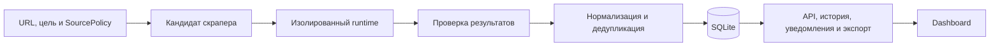

# PricePulse

PricePulse — локальный сервис мониторинга товарных цен. Он хранит источники и версии скраперов, нормализует результаты сбора, ведёт историю наблюдений и формирует уведомления об изменении цены и наличия. Данные доступны через REST API, dashboard и экспорт CSV/JSON.

Сгенерированный код выполняется в отдельном Docker-контейнере с ограничениями файловой системы, сети и ресурсов.

## Содержание

- [Функциональность](#функциональность)
- [Требования и установка](#требования-и-установка)
- [Запуск](#запуск)
- [API](#api)
- [Изолированное исполнение](#изолированное-исполнение)
- [Архитектура](#архитектура)
- [Настройка источников](#настройка-источников)
- [Тестирование](#тестирование)
- [Статус и ограничения](#статус-и-ограничения)
- [Документация](#документация)
- [Лицензия и происхождение кода](#лицензия-и-происхождение-кода)

## Функциональность

- Валидация SourcePolicy: домены, пути, robots policy, валюта и лимиты запросов.
- Версионирование кандидатов скрапера с хешами кода, зависимостей и политики; активация после проверок исполнения и данных.
- Нормализация Decimal-цен, валют, наличия, вариантов и упаковок; детерминированная дедупликация.
- Неизменяемая история наблюдений с явными состояниями missing/unknown.
- Идемпотентные задания, leases, ограниченные повторы, контроль частоты и параллельности, восстановление после сбоев.
- Уведомления об изменении цены и наличия с cooldown и дедупликацией событий.
- REST API, dashboard, журнал ошибок качества и экспорт CSV/JSON с защитой от CSV formula injection.
- Адаптеры OpenAI-compatible API, native Anthropic и Ollama с общей схемой извлечения.

## Требования и установка

| Компонент | Требование |
| --- | --- |
| Python | 3.11 или новее |
| uv | Установка зависимостей по lockfile |
| Docker | Исполнение кандидатов и проверки изоляции |
| Node.js | 18 или новее, для UI-тестов |

Команды выполняются из корня репозитория:

```sh
uv sync --locked --extra dev
uv pip install --requirement pricepulse/runtime/requirements.lock
```

Для запуска API и dashboard Docker не требуется.

## Запуск

```sh
uv run python -m pricepulse --database pricepulse.db --host 127.0.0.1 --port 8000
```

Приложение создаёт SQLite-файл, применяет миграции и запускает HTTP-сервер. Dashboard доступен по адресу http://127.0.0.1:8000/. Новая база не содержит демонстрационных данных.

Проверка доступности:

```sh
curl -fsS http://127.0.0.1:8000/health
```

Ожидаемый результат: HTTP 200, `{"status":"ok"}`.

| Параметр | Значение по умолчанию |
| --- | --- |
| `--database` | `PRICEPULSE_DATABASE` или `pricepulse.db` |
| `--host` | `127.0.0.1`; также поддерживается `::1` |
| `--port` | `8000` |

Аргумент `--database` имеет приоритет над переменной окружения. Справка доступна через `uv run python -m pricepulse --help`.

### Регулярный сбор LIME

После сборки runtime-образа API, dashboard, планировщик и worker запускаются одной командой:

```sh
uv run python -m pricepulse --database pricepulse.db --config config.limestore.json
```

При первом подключении источника цикл создаётся сразу. Затем каталог «Новинки» проверяется раз в 30 минут;
интервал отсчитывается от создания предыдущего задания. Worker получает свежий
каталог и до восьми карточек, извлекает размеры выбранного цвета, сохраняет цены
и наличие, затем оценивает сохранённые правила уведомлений. Dashboard обновляет
данные каждые 30 секунд. Для продолжения сбора процесс и Docker должны работать.

Один проход по заданиям, которым наступил срок, без HTTP-сервера:

```sh
uv run python -m pricepulse --database pricepulse.db --config config.limestore.json --once
```

Конфигурация задаёт `catalog_urls`, `interval_seconds`, `max_products`,
`max_catalog_pages`, `cooldown_seconds`, `enabled` и SourcePolicy. Изменения
применяются после перезапуска процесса. `enabled: false` отключает сбор источника.
Расписание, задания, ограничения частоты и cooldown сохраняются в SQLite.
После перезапуска worker обрабатывает очередь и восстанавливает истёкшие leases.

Лимит шесть запросов в минуту включает robots.txt и перенаправления. Ответы
401/403/429, robots-запреты и challenge останавливают цикл и включают cooldown.
Частичный результат сохраняется с фактическими счётчиками, а задание получает
`failed` или `blocked`. Неподтверждённые цены и наличие не записываются.

Адаптер LIME использует проверенный JSON-LD/Nuxt extractor без обращения к LLM.
Ограничение восьми карточек относится к одному циклу выбранного каталога;
оно не означает полный обход магазина. Query-пагинация и другие домены не разрешены.
Без `--config` приложение запускает только API/dashboard, как и раньше.

## API

JSON-запросы передаются с `Content-Type: application/json`. Для `POST /sources` обязательны поля `policy` и `goal`.

| Метод и путь | Назначение |
| --- | --- |
| `GET /health` | Проверка доступности |
| `GET, POST /sources` | Чтение и сохранение источников |
| `GET /sources/{source_id}` | Получение источника |
| `GET /sources/{source_id}/policies` | Политики источника |
| `GET /sources/{source_id}/candidates` | Кандидаты скрапера |
| `POST /sources/{source_id}/{version_id}/activate` | Активация проверенного кандидата |
| `GET /products?source_id=...` | Товары источника |
| `GET /products/{product_id}/variants` | Варианты товара |
| `GET /variants/{variant_id}/history` | История наблюдений |
| `GET /variants/{variant_id}/export?format=csv` | Экспорт истории; `format=json` для JSON |
| `GET, POST /jobs` | Чтение и идемпотентное создание заданий |
| `GET /jobs/{job_id}` | Состояние задания |
| `POST /jobs/{job_id}/cancel` | Отмена задания в состоянии `queued` |
| `GET, POST /alerts/rules` | Правила уведомлений |
| `POST /alerts/evaluate` | Оценка правил |
| `GET /alerts/events` | Журнал событий |
| `GET /quality-issues` | Ошибки качества данных |

Dashboard получает сохранённые данные через API и отображает источники, товары, историю, задания, ошибки качества и уведомления. Предусмотрены состояния loading, empty, error, stale и blocked.

## Изолированное исполнение

Сборка runtime-образа:

```sh
docker build -f Dockerfile.runtime -t pricepulse-runtime:local .
```

`SandboxedContainerRunner` использует этот образ по умолчанию. Контейнер работает от UID/GID 65532, с read-only root, выключенной сетью, сброшенными capabilities, `no-new-privileges` и лимитами CPU, памяти, PID, времени и вывода.

Проверка границ изоляции:

```sh
uv run --extra dev python scripts/run_sandbox_probe.py
```

[Compose-файл](deploy/runtime-compose.yaml) описывает worker и отдельный egress broker. Политика broker передаётся как JSON SourcePolicy в `PRICEPULSE_EGRESS_POLICY`. Сгенерированный скрапер не исполняется в процессе API или напрямую на хосте.

## Архитектура



Управляющая часть использует стандартный HTTP-сервер Python и SQLite. Dashboard состоит из статического HTML и JavaScript. Исполнение недоверенного кода и проверка внешних запросов вынесены в runtime и egress broker.

| Каталог | Назначение |
| --- | --- |
| `pricepulse/api/` | REST API, уведомления и экспорт |
| `pricepulse/collectors/` | Подключение источников, probe, synthesis и проверки |
| `pricepulse/providers/` | LLM-протоколы и схема извлечения |
| `pricepulse/runtime/` | Контейнерное исполнение |
| `pricepulse/egress/` | Сетевые ограничения |
| `pricepulse/data/`, `pricepulse/domain/` | Обработка, хранение и модели данных |
| `pricepulse/jobs/` | Задания, leases и расписания |
| `pricepulse/web/` | HTML, CSS и JavaScript dashboard |
| `migrations/` | Версии схемы SQLite |
| `scripts/`, `tests/` | Проверки runtime, поставки и функциональности |
| `deploy/`, `docs/` | Топология исполнения и документация |

## Настройка источников

Образец политики: [SOURCE_POLICY.example.json](docs/SOURCE_POLICY.example.json). Порядок подключения: [руководство onboarding](docs/source_onboarding.md).

SourcePolicy задаёт разрешённые домены и пути, валюту, timeout, частоту запросов и параллельность. Для локальных фикстур используются `live_enabled: false` и `robots_policy: operator_authorized_fixture`. Для live-режима требуются отдельное одобрение, `robots_policy: honor` и разрешённый путь получения `/robots.txt`.

Поле `drop_query_parameters` позволяет удалять неидентифицирующие tracking-параметры из canonical URL. Параметры варианта товара сохраняются. Содержимое товарных страниц не может изменять SourcePolicy.

## Тестирование

Набор тестов охватывает изоляцию контейнеров, отдельный входной захват, egress,
collectors, заглушки LLM-протоколов, обработку данных, миграции, API, задания,
плановый сбор после перезапуска, cooldown, UI, установку wheel вне checkout
и проверку происхождения кода. Тесты по умолчанию не обращаются к магазинам и LLM.

Для полного набора требуются Docker, собранный runtime-образ и Node.js 18+:

```sh
uv run --with-requirements pricepulse/runtime/requirements.lock --extra dev pytest -q
```

Запуск отдельного теста:

```sh
uv run --extra dev pytest -q tests/jobs/test_limits.py::test_availability_alerts_use_confirmed_transitions_and_durable_cooldown
```

Проверка происхождения адаптированного ядра:

```sh
uv run python scripts/verify_upstream_provenance.py
```

## Статус и ограничения

29 октября 2026 года первый живой цикл worker обработал каталог LIME «Новинки»
и шесть найденных карточек: 26 вариантов и 26 новых наблюдений. С учётом
сохранённой истории база содержит 34 наблюдения. Worker, расписание и
конфигурация `config.limestore.json` подключены к единому запуску.

| Проверка | Статус |
| --- | --- |
| Публичный источник | Первый плановый цикл LIME пройден: шесть карточек, 26 вариантов, robots policy и лимиты соблюдены |
| Live-провайдеры | Один реальный вызов Ollama `qwen2.5:7b` проверен; OpenAI и native Anthropic остаются непроверенными |

Порядок фиксации результатов приведён в [руководстве внешнего воспроизведения](docs/EXTERNAL_REPRODUCTION.md).

- Сервис рассчитан на одного оператора и доступ через loopback. Публичная многопользовательская эксплуатация требует отдельной реализации аутентификации и разграничения доступа.
- Каждая площадка подключается и проверяется отдельно. Обход блокировок и решение CAPTCHA не входят в функциональность.
- Ошибки HTTP, challenge, 401/403/429 и пустые ответы не считаются подтверждёнными наблюдениями.
- Недоступность runtime блокирует исполнение кандидата; запуск на хосте не используется.
- Проверки SQLite не подтверждают корректность распределённой эксплуатации.
- Уведомления доступны в UI/API; внешняя доставка через email или Telegram не подключена.

## Документация

- [Архитектура](docs/ARCHITECTURE.md)
- [Разработка, миграции и тесты](docs/DEVELOPMENT.md)
- [Подключение источников](docs/source_onboarding.md)
- [Модель данных](docs/DATA_MODEL.md)
- [Диагностика и quarantine](docs/TROUBLESHOOTING_QUARANTINE.md)
- [Внешние проверки](docs/EXTERNAL_REPRODUCTION.md)
- [Атрибуция](ATTRIBUTION.md)
- [История изменений](CHANGELOG.md)

## Лицензия

Проект распространяется по MIT. Полный текст лицензии и обязательные уведомления об авторских правах приведены в [LICENSE](LICENSE).
